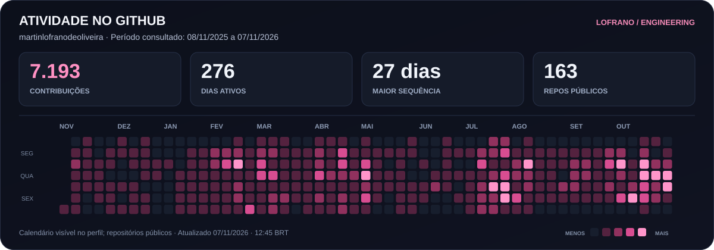
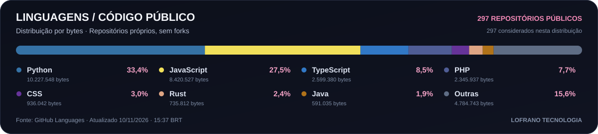
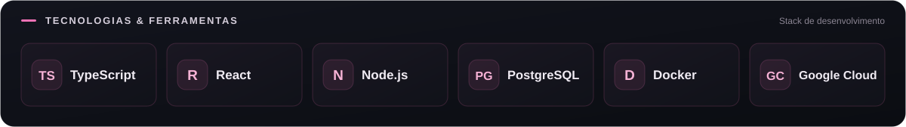

# Martin Lofrano · LOFRANO TECNOLOGIA

**Desenvolvedor Full Stack na [LOFRANO TECNOLOGIA](https://lofranotecnologia.com.br).**

Transformo necessidades de negócio em **software sob medida, agentes de IA e processos conectados**. Na LOFRANO TECNOLOGIA, desenvolvemos sistemas web, aplicações e integrações para empresas, da experiência de uso à implantação.

**[Conheça as soluções da LOFRANO TECNOLOGIA →](https://lofranotecnologia.com.br)**

  
  

## Atividade no GitHub

Dados da API do GitHub, com atualização programada quatro vezes ao dia e após alterações no catálogo deste perfil. A data da coleta aparece nos painéis; execuções agendadas podem atrasar. “Commits na consulta” mostra a contagem retornada pelo acesso automático no período exibido, que pode diferir do total visto pelo titular. As linguagens representam volume de código público, não nível de domínio.

## Stack de desenvolvimento

<strong>Mais tecnologias e ferramentas com que trabalho</strong>

- **Front-end:** TypeScript, React, Next.js, Vite e Tailwind CSS.
- **Back-end e integrações:** Node.js, Express, NestJS, APIs REST, webhooks e Stripe.
- **Dados e infraestrutura:** PostgreSQL, Supabase, Docker, Nginx e Google Cloud.

## O que construímos na LOFRANO

| Frente | Aplicações |
| --- | --- |
| **[Software sob medida](https://lofranotecnologia.com.br/servicos/desenvolvimento-de-software)** | Sistemas web, portais para clientes, plataformas internas, MVPs e modernização de aplicações. |
| **[Inteligência artificial](https://lofranotecnologia.com.br/servicos/inteligencia-artificial)** | Assistentes, consulta a documentos e agentes com fontes, permissões e critérios de avaliação definidos. |
| **[Automação de processos](https://lofranotecnologia.com.br/servicos/automacao-de-processos)** | Fluxos de aprovação, notificações, tarefas recorrentes e sincronização de dados. |
| **[Integração de sistemas](https://lofranotecnologia.com.br/servicos/integracao-de-sistemas)** | APIs e webhooks para conectar CRM, ferramentas de gestão e aplicações próprias. |

## Projeto em destaque · NexusOrchestrator Open

Uma aplicação de orquestração de agentes com servidor **Node.js/Express** e interface **React** de escritório pixelado. A edição pública reúne tarefas, salas, políticas de despacho e integrações opcionais.

**[Explorar o código do NexusOrchestrator →](https://github.com/martinlofranodeoliveira/NexusOrchestrator-open)**

A **[sede digital 3D da LOFRANO](https://lofranotecnologia.com.br/sede)** apresenta as áreas da software house e os estados compartilhados pelo NexusOrquestrator, com indicação de atualização da fonte.

<strong>Da ideia à primeira versão: como trabalhamos</strong>

1. **Conversar:** você descreve a ideia e responde às perguntas para organizar objetivo, usuários e prioridades.
2. **Visualizar:** explore modelos e aplicações demonstrativas. Se desejar, peça quatro prévias com IA, revisadas pela equipe antes do envio por e-mail.
3. **Construir:** com escopo, prazo e investimento alinhados, o desenvolvimento avança por etapas e critérios de aceite.
4. **Evoluir:** implantação, documentação e próximas entregas acompanham as necessidades do negócio.

A prévia ajuda a avaliar a solução. Engenharia, revisão e validação acompanham o desenvolvimento.

## Projetos abertos

[Explore o catálogo de projetos open source e ferramentas →](PROJETOS-ABERTOS.md)

[Consulte os commits e as evidências técnicas do portfólio →](EVIDENCIAS.md)

### Comece por estes projetos

| Projeto | O que experimentar | Abrir |
| --- | --- | --- |
| [GitHub Evidence Board](https://github.com/martinlofranodeoliveira/github-evidence-board) | Inspecionar commits, horários e cobertura de CI de repositórios públicos. | [Demo web](https://martinlofranodeoliveira.github.io/github-evidence-board/) |
| [Freebusy Slot Studio](https://github.com/martinlofranodeoliveira/freebusy-slot-studio) | Encontrar horários comuns em cenários de disponibilidade explícitos. | [Demo web](https://martinlofranodeoliveira.github.io/freebusy-slot-studio/) |
| [Schema Form Studio](https://github.com/martinlofranodeoliveira/schema-form-studio) | Gerar formulários e inspecionar validações de um recorte de JSON Schema. | [Demo web](https://martinlofranodeoliveira.github.io/schema-form-studio/) |
| [Resumable Transfer Lab · C#](https://github.com/martinlofranodeoliveira/resumable-transfer-lab) | Retomar uma transferência HTTP com checkpoint, ETag e SHA-256 esperado. | [Executar localmente](https://github.com/martinlofranodeoliveira/resumable-transfer-lab/blob/main/README.pt-BR.md) |
| [SQLite Migration Rehearsal Lab · Python](https://github.com/martinlofranodeoliveira/sqlite-migration-rehearsal-lab) | Ensaiar migrações up/down/up em cópias do banco e conferir dados. | [Executar localmente](https://github.com/martinlofranodeoliveira/sqlite-migration-rehearsal-lab/blob/main/README.pt-BR.md) |
| [MQTT Session Recovery Lab · Go](https://github.com/martinlofranodeoliveira/mqtt-session-recovery-lab) | Reproduzir recuperação de sessão e Last Will com Mosquitto isolado. | [Executar localmente](https://github.com/martinlofranodeoliveira/mqtt-session-recovery-lab/blob/main/README.pt-BR.md) |

### Aplicações 3D em React

Ilustração conceitual gerada com OpenAI GPT Image 2.6 Sunburst. As interfaces e os recursos disponíveis estão nos projetos abaixo.

| Demo | O que experimentar | Código |
| --- | --- | --- |
| [Configurador de móveis](https://martinlofranodeoliveira.github.io/cabinet-assembly-studio/) | Editar dimensões, selecionar painéis e explorar a montagem em vista explodida. | [GitHub](https://github.com/martinlofranodeoliveira/cabinet-assembly-studio) |
| [Distribuição de volumes](https://martinlofranodeoliveira.github.io/spatial-loading-studio/) | Posicionar caixas em milímetros, girar e conferir sobreposições. | [GitHub](https://github.com/martinlofranodeoliveira/spatial-loading-studio) |
| [Transformações 3D](https://martinlofranodeoliveira.github.io/frame-transform-studio/) | Editar hierarquias de coordenadas, inspecionar matrizes e comparar poses. | [GitHub](https://github.com/martinlofranodeoliveira/frame-transform-studio) |

As demos usam cenários sintéticos. Seu código e arquivos publicados foram conferidos; a revisão visual em navegador permanece pendente. Veja o alcance da validação em [EVIDENCIAS.md](EVIDENCIAS.md).

<strong>Ver os projetos desta série</strong>

<!-- FIRST-BATCH:BEGIN -->
### Primeira leva · 10 projetos abertos

**Publicado · desenvolvimento 0.1.** Esta primeira leva reúne 10 projetos abertos com documentação bilíngue, testes e demos locais. Os links de Actions permitem conferir o status atual da CI de cada repositório.

| Projeto | Linguagem | Finalidade | Consulta |
| --- | --- | --- | --- |
| [Health Probe CLI](https://github.com/martinlofranodeoliveira/health-probe-cli) | Go | Confere um GET HTTP, status esperado, latência e limite de resposta. | [Docs](https://github.com/martinlofranodeoliveira/health-probe-cli/blob/main/README.pt-BR.md) · [Actions](https://github.com/martinlofranodeoliveira/health-probe-cli/actions/workflows/ci.yml) |
| [Webhook Signature Lab](https://github.com/martinlofranodeoliveira/webhook-signature-lab) | TypeScript | Assina e verifica corpos brutos com HMAC e tempo explícito. | [Docs](https://github.com/martinlofranodeoliveira/webhook-signature-lab/blob/main/README.pt-BR.md) · [Actions](https://github.com/martinlofranodeoliveira/webhook-signature-lab/actions/workflows/ci.yml) |
| [NDJSON Redact](https://github.com/martinlofranodeoliveira/ndjson-redact) | Rust | Substitui campos de NDJSON por JSON Pointer, com limites e diagnósticos sem valores. | [Docs](https://github.com/martinlofranodeoliveira/ndjson-redact/blob/main/README.pt-BR.md) · [Actions](https://github.com/martinlofranodeoliveira/ndjson-redact/actions/workflows/ci.yml) |
| [Approval Flow Core](https://github.com/martinlofranodeoliveira/approval-flow-core) | TypeScript | Organiza transições de aprovação, versão esperada e histórico reconstruível. | [Docs](https://github.com/martinlofranodeoliveira/approval-flow-core/blob/main/README.pt-BR.md) · [Actions](https://github.com/martinlofranodeoliveira/approval-flow-core/actions/workflows/ci.yml) |
| [OpenAPI Example Check](https://github.com/martinlofranodeoliveira/openapi-example-check) | TypeScript | Confere exemplos JSON no recorte documentado de OpenAPI 3.1.1, offline. | [Docs](https://github.com/martinlofranodeoliveira/openapi-example-check/blob/main/README.pt-BR.md) · [Actions](https://github.com/martinlofranodeoliveira/openapi-example-check/actions/workflows/ci.yml) |
| [Retrieval Eval Kit](https://github.com/martinlofranodeoliveira/retrieval-eval-kit) | TypeScript | Avalia rankings rotulados com Recall@K, MRR@K, fonte e abstenção. | [Docs](https://github.com/martinlofranodeoliveira/retrieval-eval-kit/blob/main/README.pt-BR.md) · [Actions](https://github.com/martinlofranodeoliveira/retrieval-eval-kit/actions/workflows/ci.yml) |
| [Tenant Policy Lab](https://github.com/martinlofranodeoliveira/tenant-policy-lab) | SQL · PostgreSQL | Demonstra RLS por tenant com papéis distintos, dados fictícios e testes negativos. | [Docs](https://github.com/martinlofranodeoliveira/tenant-policy-lab/blob/main/README.pt-BR.md) · [Actions](https://github.com/martinlofranodeoliveira/tenant-policy-lab/actions/workflows/ci.yml) |
| [Cursor Page Kit](https://github.com/martinlofranodeoliveira/cursor-page-kit) | PHP | Demonstra paginação por chave composta, cursor validado e snapshot SQLite. | [Docs](https://github.com/martinlofranodeoliveira/cursor-page-kit/blob/main/README.pt-BR.md) · [Actions](https://github.com/martinlofranodeoliveira/cursor-page-kit/actions/workflows/ci.yml) |
| [Static Link Audit](https://github.com/martinlofranodeoliveira/static-link-audit) | Ruby | Confere destinos e fragmentos de links em uma exportação HTML local. | [Docs](https://github.com/martinlofranodeoliveira/static-link-audit/blob/main/README.pt-BR.md) · [Actions](https://github.com/martinlofranodeoliveira/static-link-audit/actions/workflows/ci.yml) |
| [Business Day Calendar](https://github.com/martinlofranodeoliveira/business-day-calendar) | Java | Calcula datas úteis com fins de semana e fechamentos explicitamente configurados. | [Docs](https://github.com/martinlofranodeoliveira/business-day-calendar/blob/main/README.pt-BR.md) · [Actions](https://github.com/martinlofranodeoliveira/business-day-calendar/actions/workflows/ci.yml) |

<!-- FIRST-BATCH:END -->

<!-- SECOND-BATCH:BEGIN -->
### Segunda leva · 8 projetos abertos

**Publicado · desenvolvimento 0.1.** Mais oito ferramentas com contratos explícitos, documentação em português e inglês, testes e demos reproduzíveis. Confira a execução atual nos links de Actions.

| Projeto | Linguagem | Finalidade | Consulta |
| --- | --- | --- | --- |
| [Trace Waterfall SVG](https://github.com/martinlofranodeoliveira/trace-waterfall-svg) | C++ | Transforma eventos de trace em SVG com faixas, tempos e prévia reproduzível. | [Docs](https://github.com/martinlofranodeoliveira/trace-waterfall-svg/blob/main/README.pt-BR.md) · [Actions](https://github.com/martinlofranodeoliveira/trace-waterfall-svg/actions/workflows/ci.yml) |
| [HAR Budget Audit](https://github.com/martinlofranodeoliveira/har-budget-audit) | Dart | Audita requisições, bytes conhecidos e latência de HAR com resultado explícito quando faltam dados. | [Docs](https://github.com/martinlofranodeoliveira/har-budget-audit/blob/main/README.pt-BR.md) · [Actions](https://github.com/martinlofranodeoliveira/har-budget-audit/actions/workflows/ci.yml) |
| [Test Shard Plan](https://github.com/martinlofranodeoliveira/test-shard-plan) | Python | Distribui testes por duração estimada e grupos de afinidade, com plano determinístico. | [Docs](https://github.com/martinlofranodeoliveira/test-shard-plan/blob/main/README.pt-BR.md) · [Actions](https://github.com/martinlofranodeoliveira/test-shard-plan/actions/workflows/ci.yml) |
| [Metric Cardinality Audit](https://github.com/martinlofranodeoliveira/metric-cardinality-audit) | Lua | Conta séries e valores de rótulos de métricas e confere orçamentos de cardinalidade. | [Docs](https://github.com/martinlofranodeoliveira/metric-cardinality-audit/blob/main/README.pt-BR.md) · [Actions](https://github.com/martinlofranodeoliveira/metric-cardinality-audit/actions/workflows/ci.yml) |
| [Sequence Gap Audit](https://github.com/martinlofranodeoliveira/sequence-gap-audit) | Elixir | Encontra intervalos ausentes, repetições e chegadas fora de ordem em logs sequenciais. | [Docs](https://github.com/martinlofranodeoliveira/sequence-gap-audit/blob/main/README.pt-BR.md) · [Actions](https://github.com/martinlofranodeoliveira/sequence-gap-audit/actions/workflows/ci.yml) |
| [HTTP Freshness Core](https://github.com/martinlofranodeoliveira/http-freshness-core) | Kotlin | Calcula frescor e decisões de cache HTTP dentro de um contrato documentado. | [Docs](https://github.com/martinlofranodeoliveira/http-freshness-core/blob/main/README.pt-BR.md) · [Actions](https://github.com/martinlofranodeoliveira/http-freshness-core/actions/workflows/ci.yml) |
| [UTC Cron Preview](https://github.com/martinlofranodeoliveira/utc-cron-preview) | C# | Mostra próximas ocorrências de expressões cron no recorte UTC suportado. | [Docs](https://github.com/martinlofranodeoliveira/utc-cron-preview/blob/main/README.pt-BR.md) · [Actions](https://github.com/martinlofranodeoliveira/utc-cron-preview/actions/workflows/ci.yml) |
| [POSIX Run Capture](https://github.com/martinlofranodeoliveira/posix-run-capture) | C | Executa um comando local com prazo, captura limitada de saída e resultado estruturado no Linux. | [Docs](https://github.com/martinlofranodeoliveira/posix-run-capture/blob/main/README.pt-BR.md) · [Actions](https://github.com/martinlofranodeoliveira/posix-run-capture/actions/workflows/ci.yml) |

<!-- SECOND-BATCH:END -->

<!-- THIRD-BATCH:BEGIN -->
### Terceira leva · 14 projetos abertos

**Publicado · desenvolvimento 0.1.** Ferramentas e laboratórios com documentação bilíngue, testes e exemplos reproduzíveis. Os links de Actions mostram o estado atual do CI. As três demos web têm arquivos publicados conferidos por HTTP; a validação visual em navegador ainda está pendente.

| Projeto | Linguagem | Finalidade | Consulta |
| --- | --- | --- | --- |
| [window-stats-stream](https://github.com/martinlofranodeoliveira/window-stats-stream) | Java | Calcula estatísticas em janelas com tempo explícito, fechamento e tratamento de eventos atrasados. | [Docs](https://github.com/martinlofranodeoliveira/window-stats-stream/blob/main/README.pt-BR.md) · [Actions](https://github.com/martinlofranodeoliveira/window-stats-stream/actions/workflows/ci.yml) |
| [sse-stream-inspector](https://github.com/martinlofranodeoliveira/sse-stream-inspector) | Rust | Inspeciona eventos SSE com parsing incremental, limites e diagnósticos de UTF-8. | [Docs](https://github.com/martinlofranodeoliveira/sse-stream-inspector/blob/main/README.pt-BR.md) · [Actions](https://github.com/martinlofranodeoliveira/sse-stream-inspector/actions/workflows/ci.yml) |
| [budget-hold-ledger](https://github.com/martinlofranodeoliveira/budget-hold-ledger) | Go | Modela reservas, despacho e custos incertos em cotas inteiras, com histórico verificável. | [Docs](https://github.com/martinlofranodeoliveira/budget-hold-ledger/blob/main/README.pt-BR.md) · [Actions](https://github.com/martinlofranodeoliveira/budget-hold-ledger/actions/workflows/ci.yml) |
| [transactional-outbox-lab](https://github.com/martinlofranodeoliveira/transactional-outbox-lab) | Python | Demonstra outbox SQLite, leases, fencing e reentrega após perda da confirmação. | [Docs](https://github.com/martinlofranodeoliveira/transactional-outbox-lab/blob/main/README.pt-BR.md) · [Actions](https://github.com/martinlofranodeoliveira/transactional-outbox-lab/actions/workflows/ci.yml) |
| [positional-record-codec](https://github.com/martinlofranodeoliveira/positional-record-codec) | PHP | Codifica e confere registros posicionais com contrato, trailer e valores inteiros exatos. | [Docs](https://github.com/martinlofranodeoliveira/positional-record-codec/blob/main/README.pt-BR.md) · [Actions](https://github.com/martinlofranodeoliveira/positional-record-codec/actions/workflows/ci.yml) |
| [rollout-rule-engine](https://github.com/martinlofranodeoliveira/rollout-rule-engine) | Ruby | Avalia regras de liberação com SemVer, dependências e distribuição determinística. | [Docs](https://github.com/martinlofranodeoliveira/rollout-rule-engine/blob/main/README.pt-BR.md) · [Actions](https://github.com/martinlofranodeoliveira/rollout-rule-engine/actions/workflows/ci.yml) |
| [cidr-subnet-planner](https://github.com/martinlofranodeoliveira/cidr-subnet-planner) | Python | Planeja sub-redes IPv4/IPv6 e VLSM com limites e conservação de endereços. | [Docs](https://github.com/martinlofranodeoliveira/cidr-subnet-planner/blob/main/README.pt-BR.md) · [Actions](https://github.com/martinlofranodeoliveira/cidr-subnet-planner/actions/workflows/ci.yml) |
| [freebusy-slot-studio](https://github.com/martinlofranodeoliveira/freebusy-slot-studio) | JavaScript | Encontra horários livres a partir de intervalos explícitos, com inspeção e exportação local. | [Docs](https://github.com/martinlofranodeoliveira/freebusy-slot-studio/blob/main/README.pt-BR.md) · [Actions](https://github.com/martinlofranodeoliveira/freebusy-slot-studio/actions/workflows/ci.yml) · [Demo](https://martinlofranodeoliveira.github.io/freebusy-slot-studio/) |
| [schema-form-studio](https://github.com/martinlofranodeoliveira/schema-form-studio) | JavaScript | Gera formulários de um subconjunto documentado de JSON Schema e explica erros. | [Docs](https://github.com/martinlofranodeoliveira/schema-form-studio/blob/main/README.pt-BR.md) · [Actions](https://github.com/martinlofranodeoliveira/schema-form-studio/actions/workflows/ci.yml) · [Demo](https://martinlofranodeoliveira.github.io/schema-form-studio/) |
| [github-evidence-board](https://github.com/martinlofranodeoliveira/github-evidence-board) | JavaScript | Inspeciona evidências de repositórios por commit, horário e cobertura de workflows. | [Docs](https://github.com/martinlofranodeoliveira/github-evidence-board/blob/main/README.pt-BR.md) · [Actions](https://github.com/martinlofranodeoliveira/github-evidence-board/actions/workflows/ci.yml) · [Demo](https://martinlofranodeoliveira.github.io/github-evidence-board/) |
| [Config Provenance Resolver](https://github.com/martinlofranodeoliveira/config-provenance-resolver) | Rust | Resolve camadas de configuração com proveniência por caminho e redação de segredos. | [Docs](https://github.com/martinlofranodeoliveira/config-provenance-resolver/blob/main/README.pt-BR.md) · [Actions](https://github.com/martinlofranodeoliveira/config-provenance-resolver/actions/workflows/ci.yml) |
| [SQLite Migration Rehearsal Lab](https://github.com/martinlofranodeoliveira/sqlite-migration-rehearsal-lab) | Python | Ensaios de migração up/down/up em cópias SQLite, conferindo esquema e dados. | [Docs](https://github.com/martinlofranodeoliveira/sqlite-migration-rehearsal-lab/blob/main/README.pt-BR.md) · [Actions](https://github.com/martinlofranodeoliveira/sqlite-migration-rehearsal-lab/actions/workflows/ci.yml) |
| [Fulfillment Reconciliation Lab](https://github.com/martinlofranodeoliveira/fulfillment-reconciliation-lab) | Go | Concilia pedidos, reservas e remessas sintéticos, destacando conflitos e evidências ausentes. | [Docs](https://github.com/martinlofranodeoliveira/fulfillment-reconciliation-lab/blob/main/README.pt-BR.md) · [Actions](https://github.com/martinlofranodeoliveira/fulfillment-reconciliation-lab/actions/workflows/ci.yml) |
| [Resumable Transfer Lab](https://github.com/martinlofranodeoliveira/resumable-transfer-lab) | C# | Demonstra retomada HTTP por Range, ETag, checkpoint e SHA-256 esperado em loopback. | [Docs](https://github.com/martinlofranodeoliveira/resumable-transfer-lab/blob/main/README.pt-BR.md) · [Actions](https://github.com/martinlofranodeoliveira/resumable-transfer-lab/actions/workflows/ci.yml) |

<!-- THIRD-BATCH:END -->

<!-- FOURTH-BATCH:BEGIN -->
### Núcleos de execução · 4 projetos abertos

**Publicado · desenvolvimento 0.1.** Bibliotecas e laboratórios com contratos de estado e recursos explícitos, testes independentes e demos locais.

| Projeto | Linguagem | Finalidade | Consulta |
| --- | --- | --- | --- |
| [Saga Compensation Lab](https://github.com/martinlofranodeoliveira/saga-compensation-lab) | Java | Demonstra compensação reversa, persistência e reconciliação de resultados incertos com serviços HTTP locais. | [Docs](https://github.com/martinlofranodeoliveira/saga-compensation-lab/blob/main/README.pt-BR.md) · [Actions](https://github.com/martinlofranodeoliveira/saga-compensation-lab/actions/workflows/ci.yml) |
| [Duplex Drain Pump](https://github.com/martinlofranodeoliveira/duplex-drain-pump) | C | Retransmite dois fluxos Linux com buffers limitados, contrapressão e half-close por direção. | [Docs](https://github.com/martinlofranodeoliveira/duplex-drain-pump/blob/main/README.pt-BR.md) · [Actions](https://github.com/martinlofranodeoliveira/duplex-drain-pump/actions/workflows/ci.yml) |
| [Guillotine Cut Plan](https://github.com/martinlofranodeoliveira/guillotine-cut-plan) | C++ | Planeja cortes guilhotinados com espessura de corte e certificado geométrico verificável. | [Docs](https://github.com/martinlofranodeoliveira/guillotine-cut-plan/blob/main/README.pt-BR.md) · [Actions](https://github.com/martinlofranodeoliveira/guillotine-cut-plan/actions/workflows/ci.yml) |
| [Deficit Round Queue](https://github.com/martinlofranodeoliveira/deficit-round-queue) | Lua | Escalona custos declarados por deficit round-robin, com filas limitadas e contabilidade exata. | [Docs](https://github.com/martinlofranodeoliveira/deficit-round-queue/blob/main/README.pt-BR.md) · [Actions](https://github.com/martinlofranodeoliveira/deficit-round-queue/actions/workflows/ci.yml) |

<!-- FOURTH-BATCH:END -->

<!-- FIFTH-BATCH:BEGIN -->
### Concorrência e integração · 3 projetos abertos

**Publicado · desenvolvimento 0.1.** Exemplos verificáveis de estado, processamento externo e integração com processos locais.

| Projeto | Linguagem | Finalidade | Consulta |
| --- | --- | --- | --- |
| [ETS Snapshot Bundles](https://github.com/martinlofranodeoliveira/ets-snapshot-bundles) | Elixir | Publica gerações imutáveis de dados ETS com leases por processo, limites e limpeza de pins. | [Docs](https://github.com/martinlofranodeoliveira/ets-snapshot-bundles/blob/main/README.pt-BR.md) · [Actions](https://github.com/martinlofranodeoliveira/ets-snapshot-bundles/actions/workflows/ci.yml) |
| [Spill Outer Join](https://github.com/martinlofranodeoliveira/spill-outer-join) | Kotlin | Faz full outer join de JSONL com ordenação externa, multiplicidade e limites compartilhados de disco. | [Docs](https://github.com/martinlofranodeoliveira/spill-outer-join/blob/main/README.pt-BR.md) · [Actions](https://github.com/martinlofranodeoliveira/spill-outer-join/actions/workflows/ci.yml) |
| [MQTT Session Recovery Lab](https://github.com/martinlofranodeoliveira/mqtt-session-recovery-lab) | Go | Exercita retained, recuperação de sessão, reinício e Last Will com um broker local próprio. | [Docs](https://github.com/martinlofranodeoliveira/mqtt-session-recovery-lab/blob/main/README.pt-BR.md) · [Actions](https://github.com/martinlofranodeoliveira/mqtt-session-recovery-lab/actions/workflows/ci.yml) |

<!-- FIFTH-BATCH:END -->

<!-- SIXTH-BATCH:BEGIN -->
### Algoritmos e laboratórios · 12 projetos abertos

**Publicado · desenvolvimento 0.1.** Ferramentas com contratos explícitos, referências, testes independentes e demos reproduzíveis.

| Projeto | Linguagem | Finalidade | Consulta |
| --- | --- | --- | --- |
| [Pairwise Fixture Plan](https://github.com/martinlofranodeoliveira/pairwise-fixture-plan) | Python | Gera fixtures que cobrem pares viáveis de opções, com restrições declarativas e verificador independente. | [Docs](https://github.com/martinlofranodeoliveira/pairwise-fixture-plan/blob/main/README.pt-BR.md) · [Actions](https://github.com/martinlofranodeoliveira/pairwise-fixture-plan/actions/workflows/ci.yml) |
| [Capability Match Core](https://github.com/martinlofranodeoliveira/capability-match-core) | PHP | Maximiza atribuições compatíveis e minimiza custo inteiro, com certificados de fluxo e custo. | [Docs](https://github.com/martinlofranodeoliveira/capability-match-core/blob/main/README.pt-BR.md) · [Actions](https://github.com/martinlofranodeoliveira/capability-match-core/actions/workflows/ci.yml) |
| [PostgreSQL Isolation Replay Lab](https://github.com/martinlofranodeoliveira/postgres-isolation-replay-lab) | Ruby | Reproduz anomalias de isolamento, rollback e retentativas com PostgreSQL próprio e barreiras. | [Docs](https://github.com/martinlofranodeoliveira/postgres-isolation-replay-lab/blob/main/README.pt-BR.md) · [Actions](https://github.com/martinlofranodeoliveira/postgres-isolation-replay-lab/actions/workflows/ci.yml) |
| [Loopback DNS Cache Lab](https://github.com/martinlofranodeoliveira/loopback-dns-cache-lab) | TypeScript | Exercita cache DNS positivo/negativo e recuperação UDP para TCP com autoridade local. | [Docs](https://github.com/martinlofranodeoliveira/loopback-dns-cache-lab/blob/main/README.pt-BR.md) · [Actions](https://github.com/martinlofranodeoliveira/loopback-dns-cache-lab/actions/workflows/ci.yml) |
| [Rollback Connectivity Timeline](https://github.com/martinlofranodeoliveira/rollback-connectivity-timeline) | Rust | Consulta conectividade ao longo de um histórico de arestas com union-find reversível. | [Docs](https://github.com/martinlofranodeoliveira/rollback-connectivity-timeline/blob/main/README.pt-BR.md) · [Actions](https://github.com/martinlofranodeoliveira/rollback-connectivity-timeline/actions/workflows/ci.yml) |
| [Orthogonal Route Core](https://github.com/martinlofranodeoliveira/orthogonal-route-core) | C++ | Roteia conectores em grade inteira com obstáculos, comprimento mínimo e desempate por curvas. | [Docs](https://github.com/martinlofranodeoliveira/orthogonal-route-core/blob/main/README.pt-BR.md) · [Actions](https://github.com/martinlofranodeoliveira/orthogonal-route-core/actions/workflows/ci.yml) |
| [Bounded Token Net](https://github.com/martinlofranodeoliveira/bounded-token-net) | Elixir | Explora modelos finitos de recursos e devolve testemunhos de deadlock e limites de exploração. | [Docs](https://github.com/martinlofranodeoliveira/bounded-token-net/blob/main/README.pt-BR.md) · [Actions](https://github.com/martinlofranodeoliveira/bounded-token-net/actions/workflows/ci.yml) |
| [Revision Validity Index](https://github.com/martinlofranodeoliveira/revision-validity-index) | Kotlin | Preserva consultas históricas por revisão ao corrigir intervalos de validade em memória. | [Docs](https://github.com/martinlofranodeoliveira/revision-validity-index/blob/main/README.pt-BR.md) · [Actions](https://github.com/martinlofranodeoliveira/revision-validity-index/actions/workflows/ci.yml) |
| [Fenced Weight Cache](https://github.com/martinlofranodeoliveira/fenced-weight-cache) | Dart | Combina cache LRU por peso, TTL e carregamento único com proteção contra resultados antigos. | [Docs](https://github.com/martinlofranodeoliveira/fenced-weight-cache/blob/main/README.pt-BR.md) · [Actions](https://github.com/martinlofranodeoliveira/fenced-weight-cache/actions/workflows/ci.yml) |
| [Mask Region Core](https://github.com/martinlofranodeoliveira/mask-region-core) | Java | Calcula componentes, buracos e distâncias quadráticas exatas em máscaras binárias, com adaptador PNG. | [Docs](https://github.com/martinlofranodeoliveira/mask-region-core/blob/main/README.pt-BR.md) · [Actions](https://github.com/martinlofranodeoliveira/mask-region-core/actions/workflows/ci.yml) |
| [Stripe Recovery Kit](https://github.com/martinlofranodeoliveira/stripe-recovery-kit) | Rust | Restaura arquivos a partir de fragmentos redundantes, tratando blocos ausentes ou corrompidos. | [Docs](https://github.com/martinlofranodeoliveira/stripe-recovery-kit/blob/main/README.pt-BR.md) · [Actions](https://github.com/martinlofranodeoliveira/stripe-recovery-kit/actions/workflows/ci.yml) |
| [Bounded Observed Set](https://github.com/martinlofranodeoliveira/bounded-observed-set) | C# | Modela conjunto replicado com remoção observada, histórico limitado e snapshots validados. | [Docs](https://github.com/martinlofranodeoliveira/bounded-observed-set/blob/main/README.pt-BR.md) · [Actions](https://github.com/martinlofranodeoliveira/bounded-observed-set/actions/workflows/ci.yml) |

<!-- SIXTH-BATCH:END -->

<!-- SEVENTH-BATCH:BEGIN -->
### Sétima leva · 7 projetos abertos

**Publicado · desenvolvimento 0.1.** Sete projetos com documentação bilíngue, testes e demos locais verificáveis. Os contratos descrevem os limites de cada implementação; consulte a execução atual nos links de Actions.

| Projeto | Linguagem | Finalidade | Consulta |
| --- | --- | --- | --- |
| [Monotone Curve Core](https://github.com/martinlofranodeoliveira/monotone-curve-core) | Dart | Interpola dados crescentes com PCHIP, derivadas, integrais e intervalos inversos explícitos. | [Docs](https://github.com/martinlofranodeoliveira/monotone-curve-core/blob/main/README.pt-BR.md) · [Actions](https://github.com/martinlofranodeoliveira/monotone-curve-core/actions/workflows/ci.yml) |
| [Selection Bitmap Core](https://github.com/martinlofranodeoliveira/selection-bitmap-core) | C# | Avalia predicados tipados em bitmaps, preservando resultados verdadeiros, falsos e desconhecidos. | [Docs](https://github.com/martinlofranodeoliveira/selection-bitmap-core/blob/main/README.pt-BR.md) · [Actions](https://github.com/martinlofranodeoliveira/selection-bitmap-core/actions/workflows/ci.yml) |
| [Source Map Chain Replay Lab](https://github.com/martinlofranodeoliveira/source-map-chain-replay-lab) | TypeScript | Reproduz mapas encadeados de código com TypeScript, esbuild e comparação com o Node. | [Docs](https://github.com/martinlofranodeoliveira/source-map-chain-replay-lab/blob/main/README.pt-BR.md) · [Actions](https://github.com/martinlofranodeoliveira/source-map-chain-replay-lab/actions/workflows/ci.yml) |
| [Revisioned FTS Search Lab](https://github.com/martinlofranodeoliveira/revisioned-fts-search-lab) | PHP | Demonstra busca FTS5, revisões, tombstones e consultas consistentes entre HTTP e SQLite. | [Docs](https://github.com/martinlofranodeoliveira/revisioned-fts-search-lab/blob/main/README.pt-BR.md) · [Actions](https://github.com/martinlofranodeoliveira/revisioned-fts-search-lab/actions/workflows/ci.yml) |
| [SMTP MIME Capture Lab](https://github.com/martinlofranodeoliveira/smtp-mime-capture-lab) | Ruby | Captura mensagens SMTP locais e inspeciona MIME com armazenamento e recuperação demonstráveis. | [Docs](https://github.com/martinlofranodeoliveira/smtp-mime-capture-lab/blob/main/README.pt-BR.md) · [Actions](https://github.com/martinlofranodeoliveira/smtp-mime-capture-lab/actions/workflows/ci.yml) |
| [Rational Polyphase Stream](https://github.com/martinlofranodeoliveira/rational-polyphase-stream) | C++ | Reamostra sequências numéricas em blocos com filtro FIR, limites e oráculo de convolução. | [Docs](https://github.com/martinlofranodeoliveira/rational-polyphase-stream/blob/main/README.pt-BR.md) · [Actions](https://github.com/martinlofranodeoliveira/rational-polyphase-stream/actions/workflows/ci.yml) |
| [Connection Handoff Reload Lab](https://github.com/martinlofranodeoliveira/connection-handoff-reload-lab) | C | Demonstra troca de gerações e transferência de conexões TCP por descritores Unix. | [Docs](https://github.com/martinlofranodeoliveira/connection-handoff-reload-lab/blob/main/README.pt-BR.md) · [Actions](https://github.com/martinlofranodeoliveira/connection-handoff-reload-lab/actions/workflows/ci.yml) |

<!-- SEVENTH-BATCH:END -->

<!-- EIGHTH-BATCH:BEGIN -->
## Oitava leva · 9 projetos abertos

**Publicado · desenvolvimento 0.1.0.** Nove projetos com documentação bilíngue, testes e demos locais. Os links de Actions permitem conferir o commit e o resultado da execução atual; os contratos registram o alcance de cada implementação.

| Projeto | Linguagem | Finalidade | Consulta |
| --- | --- | --- | --- |
| [Anchored Affine Alignment](https://github.com/martinlofranodeoliveira/anchored-affine-alignment) | Kotlin | Biblioteca de alinhamento global com custo afim de lacunas, âncoras obrigatórias, desempate determinístico e operações verificáveis. | [Docs](https://github.com/martinlofranodeoliveira/anchored-affine-alignment/blob/main/README.pt-BR.md) · [Actions](https://github.com/martinlofranodeoliveira/anchored-affine-alignment/actions/workflows/ci.yml) |
| [Control Flow Dominance Core](https://github.com/martinlofranodeoliveira/control-flow-dominance-core) | Java | Biblioteca de análise de fluxo de controle com dominância, pós-dominância condicionada à saída, dependências e laços naturais verificáveis. | [Docs](https://github.com/martinlofranodeoliveira/control-flow-dominance-core/blob/main/README.pt-BR.md) · [Actions](https://github.com/martinlofranodeoliveira/control-flow-dominance-core/actions/workflows/ci.yml) |
| [Git Bundle Merge Rehearsal](https://github.com/martinlofranodeoliveira/git-bundle-merge-rehearsal) | Ruby | Aplicação offline para ensaiar merges de bundles Git em repositório descartável, produzindo resultado verificável ou conflitos estruturados. | [Docs](https://github.com/martinlofranodeoliveira/git-bundle-merge-rehearsal/blob/main/README.pt-BR.md) · [Actions](https://github.com/martinlofranodeoliveira/git-bundle-merge-rehearsal/actions/workflows/ci.yml) |
| [gRPC Cancellation Tree Lab](https://github.com/martinlofranodeoliveira/grpc-cancel-tree-lab) | TypeScript | Laboratório gRPC sem interface gráfica para propagação de prazos, cancelamento cooperativo e contabilização de tarefas entre processos locais. | [Docs](https://github.com/martinlofranodeoliveira/grpc-cancel-tree-lab/blob/main/README.pt-BR.md) · [Actions](https://github.com/martinlofranodeoliveira/grpc-cancel-tree-lab/actions/workflows/ci.yml) |
| [Loopback TLS Rotation Lab](https://github.com/martinlofranodeoliveira/loopback-tls-rotation-lab) | Java | Laboratório JSSE para troca atômica de contexto TLS, preservação de sessões existentes e verificação local com PKI descartável. | [Docs](https://github.com/martinlofranodeoliveira/loopback-tls-rotation-lab/blob/main/README.pt-BR.md) · [Actions](https://github.com/martinlofranodeoliveira/loopback-tls-rotation-lab/actions/workflows/ci.yml) |
| [Multipart Object Commit Lab](https://github.com/martinlofranodeoliveira/multipart-object-commit-lab) | PHP | Aplicação local de upload multipart com publicação atômica de lotes, deduplicação por conteúdo e recuperação de arquivos órfãos. | [Docs](https://github.com/martinlofranodeoliveira/multipart-object-commit-lab/blob/main/README.pt-BR.md) · [Actions](https://github.com/martinlofranodeoliveira/multipart-object-commit-lab/actions/workflows/ci.yml) |
| [OFD Lock Ownership Lab](https://github.com/martinlofranodeoliveira/ofd-lock-ownership-lab) | C | Laboratório Linux de locks por faixa de bytes, com processos concorrentes, herança de descritores e aquisição com prazo explícito. | [Docs](https://github.com/martinlofranodeoliveira/ofd-lock-ownership-lab/blob/main/README.pt-BR.md) · [Actions](https://github.com/martinlofranodeoliveira/ofd-lock-ownership-lab/actions/workflows/ci.yml) |
| [Revisioned Text Buffer](https://github.com/martinlofranodeoliveira/revisioned-text-buffer) | C++ | Biblioteca de texto UTF-8 com edições múltiplas atômicas, snapshots imutáveis, posições UTF-16 e mapas explícitos de reposicionamento. | [Docs](https://github.com/martinlofranodeoliveira/revisioned-text-buffer/blob/main/README.pt-BR.md) · [Actions](https://github.com/martinlofranodeoliveira/revisioned-text-buffer/actions/workflows/ci.yml) |
| [Verified Block Delta](https://github.com/martinlofranodeoliveira/verified-block-delta) | Rust | Biblioteca de diferenças binárias com assinaturas deslizantes, operações determinísticas e aplicação verificada sem alterar o arquivo base. | [Docs](https://github.com/martinlofranodeoliveira/verified-block-delta/blob/main/README.pt-BR.md) · [Actions](https://github.com/martinlofranodeoliveira/verified-block-delta/actions/workflows/ci.yml) |

<!-- EIGHTH-BATCH:END -->

<!-- NINTH-BATCH:BEGIN -->
### Nona leva · 11 projetos abertos

**Publicado · desenvolvimento 0.1.0.** Onze projetos com documentação bilíngue, testes e demonstrações. Três aplicações React incluem cenas 3D e versões acessíveis por GitHub Pages; a revisão visual em navegador permanece pendente. Consulte o contrato e o commit de cada execução em Actions.

| Projeto | Linguagem | Finalidade | Consulta |
| --- | --- | --- | --- |
| [Cabinet Assembly Studio](https://github.com/martinlofranodeoliveira/cabinet-assembly-studio) | TypeScript | Configura um gabinete em 3D, explora a montagem e exporta medidas e componentes conceituais. | [Docs](https://github.com/martinlofranodeoliveira/cabinet-assembly-studio/blob/main/README.pt-BR.md) · [Actions](https://github.com/martinlofranodeoliveira/cabinet-assembly-studio/actions/workflows/ci.yml) |
| [Frame Transform Studio](https://github.com/martinlofranodeoliveira/frame-transform-studio) | TypeScript | Explora hierarquias de coordenadas em 3D e compara poses locais e globais. | [Docs](https://github.com/martinlofranodeoliveira/frame-transform-studio/blob/main/README.pt-BR.md) · [Actions](https://github.com/martinlofranodeoliveira/frame-transform-studio/actions/workflows/ci.yml) |
| [Integer Periodic Neighbors](https://github.com/martinlofranodeoliveira/integer-periodic-neighbors) | Python | Biblioteca de vizinhança periódica com coordenadas inteiras, reconstrução conservadora e comparação exata com um oráculo de todos os pares. | [Docs](https://github.com/martinlofranodeoliveira/integer-periodic-neighbors/blob/main/README.pt-BR.md) · [Actions](https://github.com/martinlofranodeoliveira/integer-periodic-neighbors/actions/workflows/ci.yml) |
| [Logical Snapshot Handoff Lab](https://github.com/martinlofranodeoliveira/logical-snapshot-handoff-lab) | Go | Laboratório PostgreSQL/SQLite para bootstrap por snapshot exportado, replicação lógica transacional e retomada após falhas. | [Docs](https://github.com/martinlofranodeoliveira/logical-snapshot-handoff-lab/blob/main/README.pt-BR.md) · [Actions](https://github.com/martinlofranodeoliveira/logical-snapshot-handoff-lab/actions/workflows/ci.yml) |
| [Modbus Register Replay Lab](https://github.com/martinlofranodeoliveira/modbus-register-replay-lab) | Rust | Laboratório Modbus TCP sintético com cliente, emulador independente e falhas controladas, sem hardware ou destinos externos. | [Docs](https://github.com/martinlofranodeoliveira/modbus-register-replay-lab/blob/main/README.pt-BR.md) · [Actions](https://github.com/martinlofranodeoliveira/modbus-register-replay-lab/actions/workflows/ci.yml) |
| [OCI Layer Effect Explorer](https://github.com/martinlofranodeoliveira/oci-layer-effect-explorer) | Go | Explica o sistema de arquivos efetivo de imagens OCI locais, incluindo whiteouts e origem por camada, sem executar a imagem. | [Docs](https://github.com/martinlofranodeoliveira/oci-layer-effect-explorer/blob/main/README.pt-BR.md) · [Actions](https://github.com/martinlofranodeoliveira/oci-layer-effect-explorer/actions/workflows/ci.yml) |
| [Offline Dependency Capsule](https://github.com/martinlofranodeoliveira/offline-dependency-capsule) | Kotlin | Resolve catálogos locais de dependências com restrições explícitas, mudanças mínimas no lock e resultados inconclusivos quando o orçamento termina. | [Docs](https://github.com/martinlofranodeoliveira/offline-dependency-capsule/blob/main/README.pt-BR.md) · [Actions](https://github.com/martinlofranodeoliveira/offline-dependency-capsule/actions/workflows/ci.yml) |
| [Relational Fixture Slice](https://github.com/martinlofranodeoliveira/relational-fixture-slice) | SQL | Extrai fixtures PostgreSQL limitadas, com fechamento referencial, e demonstra a restauração em outro banco vazio. | [Docs](https://github.com/martinlofranodeoliveira/relational-fixture-slice/blob/main/README.pt-BR.md) · [Actions](https://github.com/martinlofranodeoliveira/relational-fixture-slice/actions/workflows/ci.yml) |
| [Revisioned Formula Cells](https://github.com/martinlofranodeoliveira/revisioned-formula-cells) | Dart | Biblioteca de fórmulas tipadas com edições atômicas, recálculo incremental e recibos de revisão, sem eval. | [Docs](https://github.com/martinlofranodeoliveira/revisioned-formula-cells/blob/main/README.pt-BR.md) · [Actions](https://github.com/martinlofranodeoliveira/revisioned-formula-cells/actions/workflows/ci.yml) |
| [Scoped Congruence Explanations](https://github.com/martinlofranodeoliveira/scoped-congruence-explanations) | C# | Motor limitado de igualdades entre termos concretos, com congruência, escopos reversíveis e explicações de conflitos verificadas também pelo Z3. | [Docs](https://github.com/martinlofranodeoliveira/scoped-congruence-explanations/blob/main/README.pt-BR.md) · [Actions](https://github.com/martinlofranodeoliveira/scoped-congruence-explanations/actions/workflows/ci.yml) |
| [Spatial Loading Studio](https://github.com/martinlofranodeoliveira/spatial-loading-studio) | TypeScript | Planeja a ocupação volumétrica em 3D com colisões explícitas, rotações e desfazer. | [Docs](https://github.com/martinlofranodeoliveira/spatial-loading-studio/blob/main/README.pt-BR.md) · [Actions](https://github.com/martinlofranodeoliveira/spatial-loading-studio/actions/workflows/ci.yml) |

<!-- NINTH-BATCH:END -->

<!-- TENTH-BATCH:BEGIN -->
### Décima leva · 7 projetos abertos

**Publicado · desenvolvimento 0.1.0.** Sete projetos com documentação bilíngue, testes e demonstrações locais. Os contratos explicam os limites e os links de Actions permitem conferir cada execução.

| Projeto | Linguagem | Finalidade | Consulta |
| --- | --- | --- | --- |
| [Trace Context Hop Lab](https://github.com/martinlofranodeoliveira/trace-context-hop-lab) | TypeScript | Reproduz propagação de contexto W3C entre serviços locais, com OpenTelemetry e verificações de continuidade e falhas. | [Docs](https://github.com/martinlofranodeoliveira/trace-context-hop-lab/blob/main/README.pt-BR.md) · [Actions](https://github.com/martinlofranodeoliveira/trace-context-hop-lab/actions/workflows/ci.yml) |
| [Byte Corpus Suffix Index](https://github.com/martinlofranodeoliveira/byte-corpus-suffix-index) | Lua | Indexa pequenos corpora binários com array de sufixos, busca sobreposta e contagens por documento. | [Docs](https://github.com/martinlofranodeoliveira/byte-corpus-suffix-index/blob/main/README.pt-BR.md) · [Actions](https://github.com/martinlofranodeoliveira/byte-corpus-suffix-index/actions/workflows/ci.yml) |
| [Inotify Convergence Lab](https://github.com/martinlofranodeoliveira/inotify-convergence-lab) | C | Reconcilia diretórios próprios após eventos inotify, distinguindo estado atual, dados antigos e observação incompleta. | [Docs](https://github.com/martinlofranodeoliveira/inotify-convergence-lab/blob/main/README.pt-BR.md) · [Actions](https://github.com/martinlofranodeoliveira/inotify-convergence-lab/actions/workflows/ci.yml) |
| [Raster Priority Mosaic](https://github.com/martinlofranodeoliveira/raster-priority-mosaic) | Python | Produz mosaicos de rasters GeoTIFF com prioridade explícita, máscara de validade e conferência independente pelo GDAL. | [Docs](https://github.com/martinlofranodeoliveira/raster-priority-mosaic/blob/main/README.pt-BR.md) · [Actions](https://github.com/martinlofranodeoliveira/raster-priority-mosaic/actions/workflows/ci.yml) |
| [LSP Rename Rehearsal](https://github.com/martinlofranodeoliveira/lsp-rename-rehearsal) | TypeScript | Ensaia renomeação semântica em cópia própria, verifica edições e compila o resultado sem alterar a origem. | [Docs](https://github.com/martinlofranodeoliveira/lsp-rename-rehearsal/blob/main/README.pt-BR.md) · [Actions](https://github.com/martinlofranodeoliveira/lsp-rename-rehearsal/actions/workflows/ci.yml) |
| [Booklet Imposition Pack](https://github.com/martinlofranodeoliveira/booklet-imposition-pack) | PHP | Organiza páginas PDF em cadernos dobráveis, com mapa de posições e validação por estrutura, texto e rasterização. | [Docs](https://github.com/martinlofranodeoliveira/booklet-imposition-pack/blob/main/README.pt-BR.md) · [Actions](https://github.com/martinlofranodeoliveira/booklet-imposition-pack/actions/workflows/ci.yml) |
| [Audio Edit Replay Lab](https://github.com/martinlofranodeoliveira/audio-edit-replay-lab) | C# | Monta cortes e silêncio de áudio PCM por índices de amostras, com mapa de saída e conferência dos valores decodificados. | [Docs](https://github.com/martinlofranodeoliveira/audio-edit-replay-lab/blob/main/README.pt-BR.md) · [Actions](https://github.com/martinlofranodeoliveira/audio-edit-replay-lab/actions/workflows/ci.yml) |

<!-- TENTH-BATCH:END -->

<!-- ELEVENTH-BATCH:BEGIN -->
### Pacotes e ensaios nativos · 7 projetos abertos

**Publicado · desenvolvimento 0.1.** Bibliotecas e ferramentas com contratos explícitos, testes nativos, documentação bilíngue e consumo de pacotes conferido fora do código-fonte. Consulte os limites e as execuções de Actions de cada projeto.

| Projeto | Linguagem | Finalidade | Consulta |
| --- | --- | --- | --- |
| [Swift Actor Transition Rehearsal](https://github.com/martinlofranodeoliveira/swift-actor-transition-rehearsal) | Swift | Ensaios de transições em atores, com cancelamento, confirmação de etapas e resultados reproduzíveis. | [Docs](https://github.com/martinlofranodeoliveira/swift-actor-transition-rehearsal/blob/main/README.pt-BR.md) · [Actions](https://github.com/martinlofranodeoliveira/swift-actor-transition-rehearsal/actions/workflows/ci.yml) |
| [SFTP Generation Publisher](https://github.com/martinlofranodeoliveira/sftp-generation-publisher) | Rust | Publica gerações por SFTP em um servidor próprio, com verificação de arquivos e pontos de confirmação explícitos. | [Docs](https://github.com/martinlofranodeoliveira/sftp-generation-publisher/blob/main/README.pt-BR.md) · [Actions](https://github.com/martinlofranodeoliveira/sftp-generation-publisher/actions/workflows/ci.yml) |
| [Gettext Generation Workbench](https://github.com/martinlofranodeoliveira/gettext-generation-workbench) | Ruby | Cria gerações de traduções Gettext, confere arquivos GNU e mantém consultas vinculadas a uma versão. | [Docs](https://github.com/martinlofranodeoliveira/gettext-generation-workbench/blob/main/README.pt-BR.md) · [Actions](https://github.com/martinlofranodeoliveira/gettext-generation-workbench/actions/workflows/ci.yml) |
| [Julia Bounded GK Evidence](https://github.com/martinlofranodeoliveira/julia-bounded-gk-evidence) | Julia | Resume fluxos inteiros com limites de recursos e certificados de posição conferidos contra os dados de teste. | [Docs](https://github.com/martinlofranodeoliveira/julia-bounded-gk-evidence/blob/main/README.pt-BR.md) · [Actions](https://github.com/martinlofranodeoliveira/julia-bounded-gk-evidence/actions/workflows/ci.yml) |
| [Corpus Font Bundle](https://github.com/martinlofranodeoliveira/corpus-font-bundle) | Python | Produz subconjuntos TTF e WOFF2 para corpus declarado, conferindo composição de glifos e métricas com HarfBuzz. | [Docs](https://github.com/martinlofranodeoliveira/corpus-font-bundle/blob/main/README.pt-BR.md) · [Actions](https://github.com/martinlofranodeoliveira/corpus-font-bundle/actions/workflows/ci.yml) |
| [OTP State Upgrade Rehearsal](https://github.com/martinlofranodeoliveira/otp-state-upgrade-rehearsal) | Elixir | Ensaios de troca de código e migração de estado OTP, com recuperação do histórico confirmado em memória. | [Docs](https://github.com/martinlofranodeoliveira/otp-state-upgrade-rehearsal/blob/main/README.pt-BR.md) · [Actions](https://github.com/martinlofranodeoliveira/otp-state-upgrade-rehearsal/actions/workflows/ci.yml) |
| [LDAP Membership Evidence Lab](https://github.com/martinlofranodeoliveira/ldap-membership-evidence-lab) | C# | Explica caminhos de grupos LDAP sintéticos, ciclos, referências ausentes e observações incompletas. | [Docs](https://github.com/martinlofranodeoliveira/ldap-membership-evidence-lab/blob/main/README.pt-BR.md) · [Actions](https://github.com/martinlofranodeoliveira/ldap-membership-evidence-lab/actions/workflows/ci.yml) |

<!-- ELEVENTH-BATCH:END -->

<!-- TWELFTH-BATCH:BEGIN -->
### Geometria, dados e execução · 6 projetos abertos

**Publicado · desenvolvimento 0.1.0.** Seis bibliotecas e ferramentas com exemplos originais, documentação bilíngue, testes e pacotes conferidos fora do código-fonte. Os contratos descrevem os limites e distinguem resultados completos de execuções inconclusivas.

| Projeto | Linguagem | Finalidade | Consulta |
| --- | --- | --- | --- |
| [Indexed PNG Palette Pack](https://github.com/martinlofranodeoliveira/indexed-png-palette-pack) | C++ | Converte pequenos PNGs RGBA em paletas indexadas, com verificação independente dos pixels e dos limites do formato. | [Docs](https://github.com/martinlofranodeoliveira/indexed-png-palette-pack/blob/main/README.pt-BR.md) · [Actions](https://github.com/martinlofranodeoliveira/indexed-png-palette-pack/actions/workflows/ci.yml) |
| [Stratified Permutation Mass](https://github.com/martinlofranodeoliveira/stratified-permutation-mass) | R | Calcula massas combinatórias exatas de somas em atribuições finitas, preservando os totais de cada estrato. | [Docs](https://github.com/martinlofranodeoliveira/stratified-permutation-mass/blob/main/README.pt-BR.md) · [Actions](https://github.com/martinlofranodeoliveira/stratified-permutation-mass/actions/workflows/ci.yml) |
| [Parquet Schema Union Rewrite](https://github.com/martinlofranodeoliveira/parquet-schema-union-rewrite) | Python | Reescreve pequenos conjuntos Parquet em um esquema compatível, com proveniência por linha e conferência pelo DuckDB. | [Docs](https://github.com/martinlofranodeoliveira/parquet-schema-union-rewrite/blob/main/README.pt-BR.md) · [Actions](https://github.com/martinlofranodeoliveira/parquet-schema-union-rewrite/actions/workflows/ci.yml) |
| [OCaml Regular Path Witness](https://github.com/martinlofranodeoliveira/ocaml-regular-path-witness) | OCaml | Encontra percursos de grafos aceitos por expressões regulares, com testemunhas verificadas e limites explícitos de busca. | [Docs](https://github.com/martinlofranodeoliveira/ocaml-regular-path-witness/blob/main/README.pt-BR.md) · [Actions](https://github.com/martinlofranodeoliveira/ocaml-regular-path-witness/actions/workflows/ci.yml) |
| [Rational Halfspace Witnesses](https://github.com/martinlofranodeoliveira/rational-halfspace-witnesses) | Haskell | Resolve pequenos sistemas de desigualdades racionais com pontos ou certificados conferidos separadamente e resultado inconclusivo quando necessário. | [Docs](https://github.com/martinlofranodeoliveira/rational-halfspace-witnesses/blob/main/README.pt-BR.md) · [Actions](https://github.com/martinlofranodeoliveira/rational-halfspace-witnesses/actions/workflows/ci.yml) |
| [Wasm Capability Replay](https://github.com/martinlofranodeoliveira/wasm-capability-replay) | Go | Reproduz chamadas de módulos WebAssembly sintéticos, conferindo o histórico e a consistência com a entrada declarada. | [Docs](https://github.com/martinlofranodeoliveira/wasm-capability-replay/blob/main/README.pt-BR.md) · [Actions](https://github.com/martinlofranodeoliveira/wasm-capability-replay/actions/workflows/ci.yml) |

<!-- TWELFTH-BATCH:END -->

<!-- THIRTEENTH-BATCH:BEGIN -->
### Junção por similaridade, parsing preditivo, lógica temporal, tensores, geometria, grafos, cinemática 3D, robótica, binários ELF, empacotamento determinístico, cursores JDBC, orçamento geométrico GLB e transições iCalendar · Projetos abertos

**Publicado · desenvolvimento 0.1.0.** Ensaios de ligação JPMS, algoritmos exatos de junção por similaridade, contratos temporais trivalentes, otimização de árvores de tensores, parsing preditivo LL(1), fatiamento exato de malhas com aritmética racional, isomorfismo exato de grafos com refinamento 1-D Weisfeiler-Lehman, cinemática analítica de desdobramento de embalagens 3D em Three.js, bancada educacional de cinemática de braços articulados de 3 juntas rotativas, auditoria de binários ELF com arquivos de depuração auxiliares (.gnu_debuglink) em Zig, empacotador determinístico de releases ZIP em Rust, laboratório empírico de cursores e cancelamento JDBC PostgreSQL em Java 21, auditor de geometria e orçamento de recursos glTF 2.0 Binary (GLB) em C++20 e ensaio de recorrência e transições de fuso horário iCalendar em PHP 8.4.

| Projeto | Linguagem | Finalidade | Consulta |
| --- | --- | --- | --- |
| [JPMS Linkage Rehearsal](https://github.com/martinlofranodeoliveira/jpms-linkage-rehearsal) | Java | Ensaios de ligação JPMS, evolução binária de interfaces, encapsulamento e isolamento de processos no Linux. | [Docs](https://github.com/martinlofranodeoliveira/jpms-linkage-rehearsal/blob/main/README.pt-BR.md) · [Actions](https://github.com/martinlofranodeoliveira/jpms-linkage-rehearsal/actions/workflows/ci.yml) |
| [Set Overlap Join](https://github.com/martinlofranodeoliveira/set-overlap-join) | Go | Junção exata em lote por similaridade de Jaccard com indexação por prefixos e verificação inteira exata. | [Docs](https://github.com/martinlofranodeoliveira/set-overlap-join/blob/main/README.pt-BR.md) · [Actions](https://github.com/martinlofranodeoliveira/set-overlap-join/actions/workflows/ci.yml) |
| [Temporal Obligation Core](https://github.com/martinlofranodeoliveira/temporal-obligation-core) | PHP | Contratos temporais offline sob Strong Kleene com memoização compacta e operador Until incremental. | [Docs](https://github.com/martinlofranodeoliveira/temporal-obligation-core/blob/main/README.pt-BR.md) · [Actions](https://github.com/martinlofranodeoliveira/temporal-obligation-core/actions/workflows/ci.yml) |
| [Tensor Order Core](https://github.com/martinlofranodeoliveira/tensor-order-core) | C++ | Otimização combinatória exata de árvores binárias de contração de tensores com DP sobre bipartições e aritmética checada em 128 bits. | [Docs](https://github.com/martinlofranodeoliveira/tensor-order-core/blob/main/README.pt-BR.md) · [Actions](https://github.com/martinlofranodeoliveira/tensor-order-core/actions/workflows/ci.yml) |
| [Predictive Grammar Kit](https://github.com/martinlofranodeoliveira/predictive-grammar-kit) | Rust | Análise de gramáticas livres de contexto, derivação de FIRST/FOLLOW e parsing preditivo LL(1) bounded em arena. | [Docs](https://github.com/martinlofranodeoliveira/predictive-grammar-kit/blob/main/README.pt-BR.md) · [Actions](https://github.com/martinlofranodeoliveira/predictive-grammar-kit/actions/workflows/ci.yml) |
| [Mesh Section Loops](https://github.com/martinlofranodeoliveira/mesh-section-loops) | C# | Fatiamento exato de malhas fechadas 2-variedades em polígonos planares 2D com aritmética racional e simplificação colinear. | [Docs](https://github.com/martinlofranodeoliveira/mesh-section-loops/blob/main/README.pt-BR.md) · [Actions](https://github.com/martinlofranodeoliveira/mesh-section-loops/actions/workflows/ci.yml) |
| [Colored Graph Witness](https://github.com/martinlofranodeoliveira/colored-graph-witness) | Kotlin | Isomorfismo exato de grafos pequenos direcionados e rotulados com refinamento 1-D Weisfeiler-Lehman e busca com retrocesso. | [Docs](https://github.com/martinlofranodeoliveira/colored-graph-witness/blob/main/README.pt-BR.md) · [Actions](https://github.com/martinlofranodeoliveira/colored-graph-witness/actions/workflows/ci.yml) |
| [Carton Hinge Studio](https://github.com/martinlofranodeoliveira/carton-hinge-studio) | TypeScript | Cinemática analítica de desdobramento de embalagens retangulares em 3D (Three.js), convergência de junções e exportação de faca de corte em SVG. | [Docs](https://github.com/martinlofranodeoliveira/carton-hinge-studio/blob/main/README.pt-BR.md) · [Actions](https://github.com/martinlofranodeoliveira/carton-hinge-studio/actions/workflows/ci.yml) |
| [Reach Branch Studio](https://github.com/martinlofranodeoliveira/reach-branch-studio) | TypeScript | Cinemática analítica de braço robótico com 3 juntas rotativas (Three.js), enumeração de ramos de cotovelo, alternativas radiais e rejeição por limites articulares. | [Docs](https://github.com/martinlofranodeoliveira/reach-branch-studio/blob/main/README.pt-BR.md) · [Actions](https://github.com/martinlofranodeoliveira/reach-branch-studio/actions/workflows/ci.yml) |
| [Debuglink Companion Audit](https://github.com/martinlofranodeoliveira/zig-debuglink-companion-audit) | Zig | Auditor de binários ELF e arquivos de depuração auxiliares (.gnu_debuglink) com verificação de CRC32 IEEE 802.3, interoperabilidade libelf e barreiras contra TOCTOU. | [Docs](https://github.com/martinlofranodeoliveira/zig-debuglink-companion-audit/blob/main/README.pt-BR.md) · [Actions](https://github.com/martinlofranodeoliveira/zig-debuglink-companion-audit/actions/workflows/ci.yml) |
| [Reproducible ZIP Release Packer](https://github.com/martinlofranodeoliveira/rust-reproducible-zip-release) | Rust | Empacotador delimitado de releases para arquivos próprios com bytes ZIP estáveis sob compressão fixada, concessão cooperativa de fontes e publicação atômica via linkat. | [Docs](https://github.com/martinlofranodeoliveira/rust-reproducible-zip-release/blob/main/README.pt-BR.md) · [Actions](https://github.com/martinlofranodeoliveira/rust-reproducible-zip-release/actions/workflows/ci.yml) |
| [JDBC Cursor & Cancellation Rehearsal](https://github.com/martinlofranodeoliveira/java-jdbc-cursor-rehearsal) | Java | Laboratório de cursores no servidor PostgreSQL, consumo delimitado, inspeção de portais em pg_cursors e cancelamento de buscas via PGConnection. | [Docs](https://github.com/martinlofranodeoliveira/java-jdbc-cursor-rehearsal/blob/main/README.pt-BR.md) · [Actions](https://github.com/martinlofranodeoliveira/java-jdbc-cursor-rehearsal/actions/workflows/ci.yml) |
| [GLB Geometry Budget](https://github.com/martinlofranodeoliveira/cpp-glb-geometry-budget) | C++ | Auditor delimitado de geometria e orçamento de recursos para arquivos glTF 2.0 Binary (GLB) em C++20 com alocador seguro, transformações em dupla precisão e oráculo Khronos. | [Docs](https://github.com/martinlofranodeoliveira/cpp-glb-geometry-budget/blob/main/README.pt-BR.md) · [Actions](https://github.com/martinlofranodeoliveira/cpp-glb-geometry-budget/actions/workflows/ci.yml) |
| [iCalendar Transition Rehearsal](https://github.com/martinlofranodeoliveira/php-ical-transition-rehearsal) | PHP | Motor de ensaio de recorrência iCalendar (RFC 5545) com Sabre VObject, resolução física de instantes UTC, políticas para lacunas e dobras e oráculo zdump. | [Docs](https://github.com/martinlofranodeoliveira/php-ical-transition-rehearsal/blob/main/README.pt-BR.md) · [Actions](https://github.com/martinlofranodeoliveira/php-ical-transition-rehearsal/actions/workflows/ci.yml) |

<!-- THIRTEENTH-BATCH:END -->

<!-- FOURTEENTH-NATIVE-BATCH:BEGIN -->
### Bibliotecas nativas · Racket, D, Nim e Fortran

Implementações com limites explícitos, documentação e ensaios nativos. Consulte os contratos e as execuções de Actions para conferir a versão examinada.

| Projeto | Linguagem | Finalidade | Consulta |
| --- | --- | --- | --- |
| [Finite Rule Provenance](https://github.com/martinlofranodeoliveira/finite-rule-provenance) | Racket | Biblioteca limitada de Datalog estratificado que calcula pontos fixos relacionais finitos e registra uma derivação determinística por fato derivado, incluindo evidência explícita de ausência em estratos inferiores. | [Docs](https://github.com/martinlofranodeoliveira/finite-rule-provenance/blob/main/README.pt-BR.md) · [Actions](https://github.com/martinlofranodeoliveira/finite-rule-provenance/actions/workflows/ci.yml) |
| [Keyed Tree Merge](https://github.com/martinlofranodeoliveira/keyed-tree-merge) | D | Biblioteca determinística de mesclagem em três vias para árvores enraizadas sem ordenação entre irmãos, com identificadores estáveis, campos escalares tipados e evidências explícitas de conflitos estruturais. | [Docs](https://github.com/martinlofranodeoliveira/keyed-tree-merge/blob/main/README.pt-BR.md) · [Actions](https://github.com/martinlofranodeoliveira/keyed-tree-merge/actions/workflows/ci.yml) |
| [Bounded Canonical Prefix](https://github.com/martinlofranodeoliveira/bounded-canonical-prefix) | Nim | Biblioteca de tabelas Huffman canônicas com comprimento limitado, otimização determinística por package-merge e um pequeno formato binário explicitamente especificado, verificado por consumidor nativo independente. | [Docs](https://github.com/martinlofranodeoliveira/bounded-canonical-prefix/blob/main/README.pt-BR.md) · [Actions](https://github.com/martinlofranodeoliveira/bounded-canonical-prefix/actions/workflows/ci.yml) |
| [Scaled QR Evidence](https://github.com/martinlofranodeoliveira/scaled-qr-evidence) | Fortran | Biblioteca limitada de mínimos quadrados densos com QR Householder original, escalonamento e pivoteamento de colunas, refinamento iterativo limitado e diagnósticos numéricos verificados por oráculo SVD nativo do LAPACK. | [Docs](https://github.com/martinlofranodeoliveira/scaled-qr-evidence/blob/main/README.pt-BR.md) · [Actions](https://github.com/martinlofranodeoliveira/scaled-qr-evidence/actions/workflows/ci.yml) |
<!-- FOURTEENTH-NATIVE-BATCH:END -->

---

### Vamos construir seu próximo sistema?

**[Comece pelo Estúdio LOFRANO →](https://lofranotecnologia.com.br/criar-projeto)**

[Site oficial](https://lofranotecnologia.com.br) · [Contato](https://lofranotecnologia.com.br/contato) · [Insights sobre software e IA](https://lofranotecnologia.com.br/blog) · [LinkedIn](https://www.linkedin.com/in/martinlofrano/)
