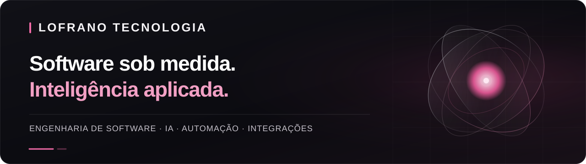
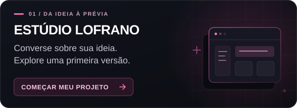
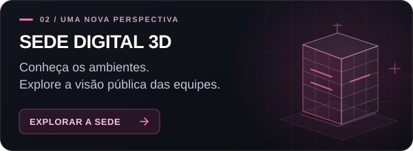
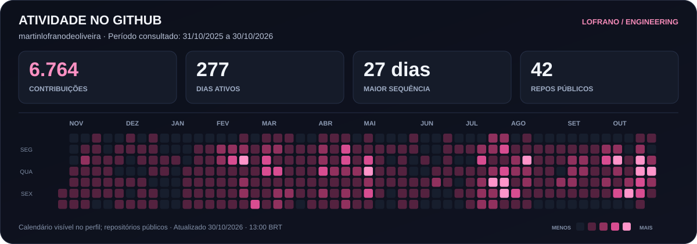
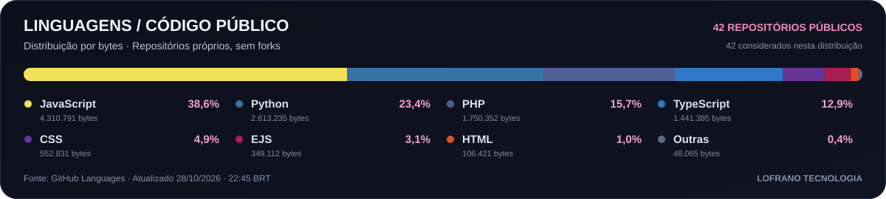
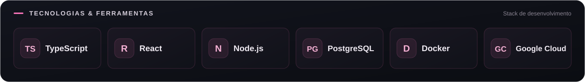

# Martin Lofrano

**Desenvolvedor Full Stack na [LOFRANO TECNOLOGIA](https://lofranotecnologia.com.br).**

Transformo necessidades de negócio em **software sob medida, agentes de IA e processos conectados**. Meu trabalho reúne interfaces, back-end, integrações e implantação, com atenção à experiência de uso e ao funcionamento de cada sistema.

  
  

## Atividade no GitHub

Dados consultados na API do GitHub; a data da última atualização aparece nos painéis. As linguagens representam volume de código público, não nível de domínio.

## Stack de desenvolvimento

<strong>Mais tecnologias e ferramentas com que trabalho</strong>

- **Front-end:** TypeScript, React, Next.js, Vite e Tailwind CSS.
- **Back-end e integrações:** Node.js, Express, NestJS, APIs REST, webhooks e Stripe.
- **Dados e infraestrutura:** PostgreSQL, Supabase, Docker, Nginx e Google Cloud.

## O que construímos na LOFRANO

| Frente | Aplicações |
| --- | --- |
| **[Software sob medida](https://lofranotecnologia.com.br/servicos/desenvolvimento-de-software)** | Sistemas web, portais para clientes, plataformas internas, MVPs e modernização de aplicações. |
| **[Inteligência artificial](https://lofranotecnologia.com.br/servicos/inteligencia-artificial)** | Assistentes, consulta a documentos e agentes com fontes, permissões e critérios de avaliação definidos. |
| **[Automação de processos](https://lofranotecnologia.com.br/servicos/automacao-de-processos)** | Fluxos de aprovação, notificações, tarefas recorrentes e sincronização de dados. |
| **[Integração de sistemas](https://lofranotecnologia.com.br/servicos/integracao-de-sistemas)** | APIs e webhooks para conectar CRM, ferramentas de gestão e aplicações próprias. |

## Projeto em destaque · NexusOrchestrator Open

Uma aplicação de orquestração de agentes com servidor **Node.js/Express** e interface **React** de escritório pixelado. A edição pública reúne tarefas, salas, políticas de despacho e integrações opcionais.

**[Explorar o código do NexusOrchestrator →](https://github.com/martinlofranodeoliveira/NexusOrchestrator-open)**

A **[sede digital 3D da LOFRANO](https://lofranotecnologia.com.br/sede)** apresenta as áreas da software house e os estados compartilhados pelo NexusOrquestrator, com indicação de atualização da fonte.

<strong>Da ideia à primeira versão: como trabalhamos</strong>

1. **Conversar:** você descreve a ideia e responde às perguntas para organizar objetivo, usuários e prioridades.
2. **Visualizar:** revise o briefing, explore o rascunho de telas e solicite uma prévia dos agentes de IA.
3. **Construir:** com escopo, prazo e investimento alinhados, o desenvolvimento avança por etapas e critérios de aceite.
4. **Evoluir:** implantação, documentação e próximas entregas acompanham as necessidades do negócio.

A prévia ajuda a avaliar a solução. Engenharia, revisão e validação acompanham o desenvolvimento.

---

### Vamos construir seu próximo sistema?

**[Comece pelo Estúdio LOFRANO →](https://lofranotecnologia.com.br/criar-projeto)**

[Site oficial](https://lofranotecnologia.com.br) · [Contato](https://lofranotecnologia.com.br/contato) · [Insights sobre software e IA](https://lofranotecnologia.com.br/blog) · [LinkedIn](https://www.linkedin.com/in/martinlofrano/)
